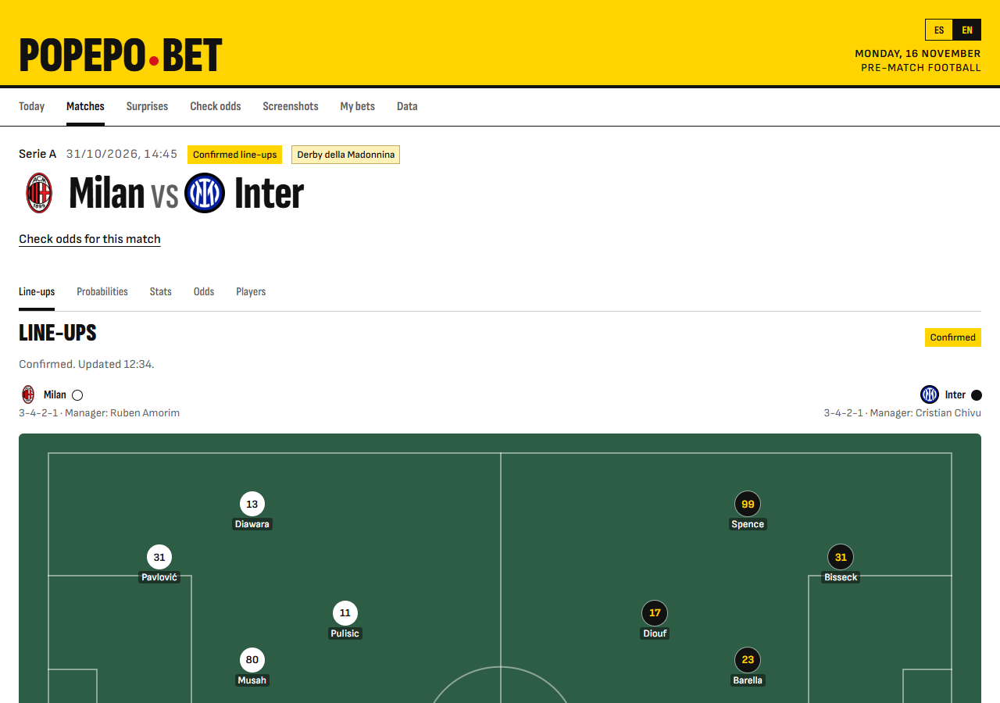
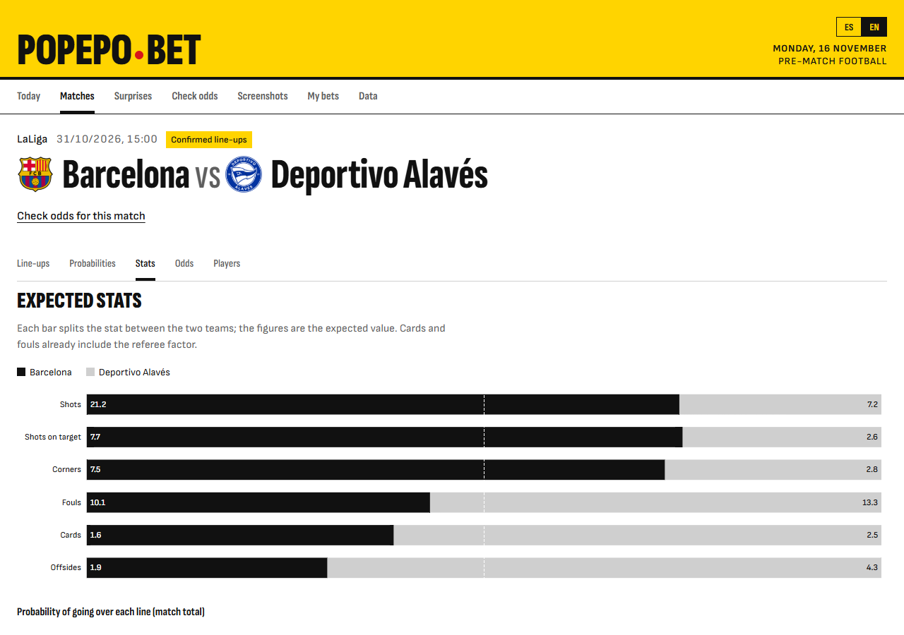
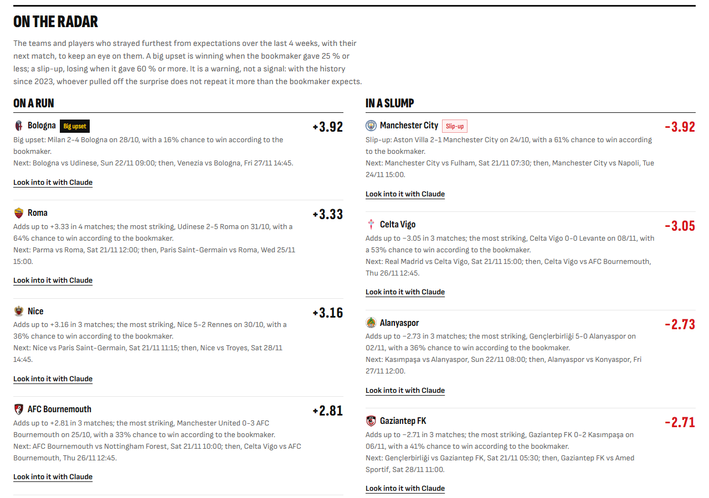

# Popepo-Bet ⚽

**English** · [Español](README.es.md)

[](LICENSE)

**A football betting model that tells you when *not* to bet.** Most betting projects promise profits. This one backtests where its model does *not* beat the bookmaker, publishes it, and only suggests a bet of the day when a bet clears a value and confidence threshold. Some days the answer is "no bet today".



**Pre-match** analysis for the **Premier League, Bundesliga, LaLiga, Serie A, Ligue 1, Primeira Liga (Portugal), Pro League (Belgium), Süper Lig (Turkey) and Champions League**, plus the **UEFA Nations League** (national teams: analysis and odds, but no bet of the day and no player markets). It computes the probability of every market (goals, handicaps, shots, corners, fouls, cards, offsides and players) and compares it with the bookmaker's odds (bet365, Betano) and with Pinnacle's fair price. Use it from a **web dashboard**, from Claude (or any other agent) through **MCP**, from a **REST API** or from **Telegram**. All on free data.

| Expected stats for each team | On the radar: teams on a run and in a slump |
|---|---|
|  |  |

It doesn't promise profits: the backtest honestly shows where the model does not beat the bookmaker (see [below](#backtest-results-honest)). Ideas, bugs or a missing league? Open an *issue*, in English or Spanish.

## What it does

- **Collects free data**: football-data.co.uk (results, stats and bet365 closing odds), FotMob (Opta data: stats, predicted and confirmed line-ups, injuries, suspensions, referees and per-player stats; for the Europa League and the Conference only the referee and team stats of played matches, without line-ups or players). Since 2026-27 football-data also brings xG, which is averaged with FotMob's. Optional: OddsPapi for **Betano** and Pinnacle odds before each match. See [docs/fuentes.md](docs/fuentes.md).
- **Cross-checks the sources**: counts (shots, corners, cards…) are compared and discrepancies flagged; xG is averaged across providers. If a source goes down, the others keep going and the dashboard shows why.
- **Models**: joint attack and defence strength for 17 competitions (the big five leagues, Portugal, Belgium, Turkey, the Champions League, the Europa League, the Conference and six more leagues that link the scale for European opponents and promoted teams), with the ratings implied by closing odds. National teams (Nations League, with the European World Cup qualifiers, the 2026 World Cup and Euro 2024 as history) are fitted in the same model, but only with goals and xG: there are no closing odds for national teams. Dixon-Coles for goals and negative binomial for shots, shots on target, corners, fouls and cards, with a **referee factor** and the split between the two teams guided by the bookmaker's 1X2. See [docs/modelos.md](docs/modelos.md).
- **Players**: goals, assists and "goal or assist" as a share of their team's goals; shots, shots on target, fouls and cards per player, with their expected minutes.
- **Line-ups and absences**: compares the XI (predicted or confirmed) with the team's usual XI using each player's market value and rating. Missing a Szoboszlai lowers Liverpool's attack and defence. The confirmed XI is checked 70, 50, 35, 20 and 10 minutes before kick-off.
- **Opponent difficulty** for each team (Easy → Hard) and **context**: rest, congested schedule and rotation risk if the team plays the Champions League within 4 days.
- **Expected value** against bet365 and Betano odds, blending the model with the sharp market (Pinnacle, Betfair).
- **Bet of the day**: the one with the highest value × confidence among those that clear the threshold (among other things, a probability of 60 % or more; the value lists don't show bets below that either). If none clears it, **there is no bet of the day**. Every bet that clears the threshold is saved and settled automatically, with its own hit counter. The counters measure the odds and value that were announced, even if a later recalculation changes them or withdraws the bet. The bet of the day can change during the day (when recalculating or when line-ups come out), but the record counts **one per day**: the one with the highest value × confidence among those that were the bet of the day, regardless of whether it won or lost. Days still to come show a candidate that doesn't count.
- **The betting table**: when the line-up for the bet of the day is confirmed, two Claude reviewers look for news for and against it, and seven Claude agents with different bettor personalities (the Cautious One, the Odds Hunter, the Statistician, the Sceptic, the Reporter, the Streak Rider and the Contrarian) vote yes or no in two rounds. Below the bet you see "Approved by the agents", "Partly approved" or "Rejected by the agents", with each agent's vote and reason. Each vote weighs between ×0.5 and ×2 depending on what it would have won or lost. The confidence against your 80 % and whether the bet goes against a team on a streak are computed by the program. It's an opinion that hasn't been measured yet: it doesn't change the probability or which bet is picked, and with the AI switched off it isn't written.
- **Accumulators and Bet Builders**: selections from the same match are evaluated together with the scoreline matrix (they are correlated) and those from different matches are multiplied.
- **Screenshots**: upload a Betano or bet365 screenshot and a local AI reads it; the model gives a verdict on each price.
- **Surprises**: the team, player and XI of the week or month that most beat expectations, a radar of teams on a hot or cold streak, warnings on bets when one of them plays, and "Why it failed" when the bet of the day loses.
- **Minimum odds** for props (shots, cards, corners, players): the price from which it's worth it on Betano.
- **Tracking** of your bets: automatic settlement, ROI, CLV, bankroll, performance by market, competition and bookmaker, and loss limits.
- **Tiered storage** (current season / history / Parquet archive) with season summaries.

## Getting started

It runs on Linux (Arch, Fedora, Debian, Ubuntu…), macOS and Windows (with WSL or Git Bash). The guide with the steps for each system, updating and common problems is **[docs/instalacion.md](docs/instalacion.md)**. In short:

1. Install Git, Python 3.12 or later, PostgreSQL and Node.js 20.9 or later (the command for your system is in the guide).
2. Download and install; the first run takes about 1 hour because it downloads the match history (the oldest match details keep downloading in the background over the first 2-3 days):

```bash
git clone https://github.com/Renindstone/Popepo-Bet.git && cd Popepo-Bet
scripts/instalar.sh
```

3. Start it and open the dashboard at http://localhost:3000:

```bash
scripts/install-services.sh --with-web   # Linux and Windows with WSL: database, worker, API and dashboard keep running on their own
scripts/arrancar.sh                      # macOS and Windows without WSL: everything in that terminal; Ctrl+C stops it
```

## Daily use

The command-line interface speaks Spanish (`apuestas` means "bets"):

| Command | What for |
|---|---|
| `apuestas picks` | Bet of the day + other value bets + props to review |
| `apuestas analyze "Arsenal vs Chelsea"` | Full analysis of a match (`--json` for all the detail) |
| `apuestas semana` | Team, player and XI of the week (`--semana YYYY-MM-DD` for another one, `--mes` for the 4 weeks ending in it, `--json` for the detail) |
| `apuestas evaluate "Arsenal vs Chelsea" ou_cards over 1.85 --line 4.5` | Is this Betano price worth it? |
| `apuestas status` | Freshness of the sources and the model |
| `apuestas settle` | Settles picks and bets of finished matches now (the worker does it on its own) |
| `apuestas ingest oddspapi --estado` | OddsPapi requests used this month (free quota: 250) |
| `apuestas backtest` | Validates the model against historical bet365 odds |
| `apuestas archive report` | Disk space used |
| `apuestas equipos duplicados` | Teams that look like the same club in two sources (the safe ones are merged automatically on every ingest) |

### Connecting Claude (MCP)

The repository includes [.mcp.json](.mcp.json): open Claude Code in this folder and the `apuestas` server shows up. For Claude Desktop, add the same block to its configuration. Tools (named in Spanish): `apuesta_del_dia`, `comparar_casas`, `historial_apuesta_del_dia`, `analizar_partido`, `evaluar_cuota`, `evaluar_combinada`, `resumen_semana`, `datos_radar`, `datos_fallo`, `bajas_equipo`, `registrar_baja`, `perfil_arbitro`, `proyeccion_jugador`, `registrar_apuesta`, `mis_apuestas`, `mi_rendimiento`, `estado_datos`, `capturas_pendientes`, `ver_captura`, `evaluar_captura`, etc.

### Several users (each with their own agent)

Anyone can install their own copy following [docs/instalacion.md](docs/instalacion.md). If you'd rather let other people use **your** installation, each with their own AI agent, give each of them their own key:

```bash
apuestas user create-key pedro          # creates that user's key (shown once)
apuestas mcp --http --port 8765         # MCP server with key authentication
```

Each user adds the server with their key as `Authorization: Bearer apk_...`, and their bets and performance stay separate from everyone else's. For example, in Claude Code:
`claude mcp add --transport http apuestas https://YOUR_HOST/mcp --header "Authorization: Bearer apk_..."`.
To expose it outside your network use a tunnel (Cloudflare Tunnel or Tailscale Funnel).

### Web dashboard

Visual interface in [web/](web/) (Next.js + ECharts). It needs Node.js 20.9 or later. Its pages and features:
- **Offsides**: the model computes them like corners or cards, with how often each team is caught offside and how often it catches the opponent (Barça's high line). They appear in the match's Stats tab and in Evaluate odds ("Offsides: over/under", for the match or for one team), with a warning when a team catches its opponent offside far more than average. Betano doesn't provide those odds through OddsPapi: you enter them by hand.
- **Unusual starters**: in the match line-ups, in Players and in Today's Props, a starter who started 2 or fewer of their team's previous 10 matches gets the label "Unusual: 1 of 10". It's just information: they shoot slightly less than in their earlier starts, and the model already accounts for it.
- **Each team's schedule**: on the match page (Stats → Referee and context) you see the rest days, the matches in 14 days and the previous and next opponent, marked if they are big teams or Champions League games, with the warning "Small opponent between big matches". Those warnings and the derby one also show up in Evaluate odds when you pick the match. They only inform: measured on 2024-26, they don't move the probability.
- **Derbies and rivalries**: 46 rivalries from the eight leagues carry their label ("El Clásico", "Merseyside derby"…) on Today, Matches, the match page and Evaluate odds. In them the model expects more fouls (×1.08) and cards (×1.25), measured on the 2024-26 ones, and the match's Stats tab shows the latest head-to-heads. The list is in `src/apuestas/core/rivalries.py`.
- **Today**: the front page. The bet of the day as the headline, with its stats card (odds, probability, fair odds, expected value, confidence and stake); next to it, **Matchday** (the day's matches by competition, with the model's 1X2). Below, three tabs showing how many rows each has: **Value** (other value bets, by default the ones that **clear the** value, probability and confidence **threshold** first, with their own hit counter; on past days, with their result. A selector also sorts them by **most likely**, **most confident** or **most value**, and the browser remembers the choice. Odds below 1.20 are hidden, `APUESTAS_VALUE_LIST_MIN_ODDS`), **Props** (minimum odds) and **Against Pinnacle** (Betano prices that pay at least 2 % more than Pinnacle's fair odds, with no model: price comparison; it happens mostly in corners and cards). The tab is kept in the address (`#valor`, `#props`, `#precio`) and stays when moving to the previous or next day. Tapping the bet of the day, or one that clears the threshold, opens **Evaluate odds** with the bet, the odds and the bookmaker already filled in and evaluated, ready to log it; tapping the teams opens the match analysis. The dashboard has its own "sports newspaper front page" design. Plus a quick spot to upload screenshots and the bet of the day's **hit counter** since the start (won, lost, void, pending and profit staking 1 unit per bet).
- **Matches**: upcoming matches with filters by competition and days, and a search box (magnifier) that filters as you type either team's name; it ignores accents and understands initials such as "psg". Picking one shows the full match analysis in five tabs: **Line-ups** (on the pitch like FotMob: the predicted ones until they're confirmed, checked 70, 50, 35, 20 and 10 minutes before kick-off, with formation, coach, shirt numbers, substitutes, absences and how the expected goals change), **Probabilities**, **Stats** (with the referee and the context), **Odds** (the ones with value and the minimum odds for props) and **Players**. The tab is kept in the address (for example `#cuotas`), so it can be bookmarked or shared.
- **Surprises** (formerly "Week"; `/semana` leads here): the **team**, the **player** and the **XI of the week** or **of the month** (the 4 full weeks ending in the chosen one; available once there are 4 weeks with a saved preview, from 23-11-2026), and the top 10 of each. Teams are measured against the bookmaker (result, goals and corners against the no-vig 1X2 and the main line before the match) and players against what the model expected before the match (shots, on target, goals and assists, adjusted for their minutes). Each item adds −1 to +1 depending on how unusual it was: going over 9.5 corners with 15 is worth more than with 10, and winning as an underdog more than as a favourite. It's a summary, not a prediction. Weeks are browsed with the arrows; players count from 24-10-2026, when the preview started to be saved.
  - **On the radar**: teams on a hot and a cold streak and players on a hot streak over the last 4 weeks, with the reason (an **upset win** is winning when the bookmaker gave 25 % or less; a **slip**, losing when it gave 60 % or more), their key players and their next match. The owner can ask "Investigate with Claude".
  - **Warnings**: on the bet of the day, "Value", the match list and the match page, when a team from the radar plays, with or without its key players in the XI. They are warnings: they don't change the probability or the threshold.
  - **Why it failed**: when the bet of the day loses, what the preview expected against what happened, whether "Surprises" already warned about it and an explanation written by Claude from the news, with its sources (using the PC's subscription, like the screenshots).
- **AI switch**: at the bottom of Data, each user decides whether to use the AI. Switched off, the screenshots and Claude's explanations disappear; the model's numbers don't change.
- **Evaluate odds**: check a Betano price and log the bet. The match is picked in two steps: first the **league** (with how many matches it has in the next 7 days) and then the match, by day. When you pick a match, **the Betano odds already downloaded** that morning appear below, evaluated by the model (value ones first): **Evaluate** sends them to the form and **+ Slip** adds them to the bet slip, no screenshot needed. With **Add to slip** you combine several selections: several from the same match make a Bet Builder (type the odds your bookmaker gives you) and those from different matches an accumulator. **Evaluate slip** computes each match and the total with the model, and **Log slip** saves it as a single bet that settles itself: one lost selection is enough to lose it, and if one is voided the total odds are adjusted.
- **Screenshots**: upload or paste an odds screenshot. An AI reads it (local by default, or Claude with a button) and the model gives a verdict on each price (see below).
- **My bets**: ROI, CLV, breakdown and bankroll, the bet of the day's history (since the start and over the last year) and that of **every bet that clears the threshold** (hits since the start and the last 60 days with their result and their **CLV**: the odds taken against Pinnacle's no-vig fair odds about 15 minutes before the match). The **starting bankroll** (and its currency) is edited right there; the suggested stake and the loss limits come from it, and the current bankroll is the starting one plus what was won or lost.
- **Language**: the **ES / EN** switch in the header puts the whole dashboard in Spanish or English, with Betano's market names in each language (Más/Menos ↔ Over/Under, Ambos marcan ↔ Both Teams To Score). The browser remembers it; the first time it follows the browser's language. The texts sent by the API (reasons, warnings, errors) also arrive translated, and in Spanish the national teams show their Spanish names (Alemania, Islas Feroe); Claude's explanations and screenshot summaries stay in the language they were written in.
- **Data**: freshness of the sources and the model. The **Sync** button (next to "Sources") downloads right away what runs at 05:30 and 08:30 from FotMob and football-data, settles and retrains the model (`POST /sync`; it takes a few minutes, uses no OddsPapi requests and can be repeated every 10 minutes).

With the services installed (`scripts/install-services.sh --with-web`), the dashboard is always at **http://localhost:3000**. To develop it by hand, stop the services first (`systemctl --user stop apuestas-web apuestas-api`) and run:

```bash
.venv/bin/apuestas api        # API at http://127.0.0.1:8000; leave it running in another terminal
cd web
npm install                   # first time only
npm run dev                   # dashboard at http://localhost:3000
```

For daily use, the `apuestas-web` service already builds and serves the production version (`npm run build && npm start`).

- The dashboard calls the API from the browser. The API only accepts requests from the dashboard opened at `http://localhost:3000` or `http://127.0.0.1:3000` (CORS), so open it at one of those addresses.
- From the same machine the API doesn't ask for a key. If the API runs on another machine (for example, behind a tunnel), copy `web/.env.example` to `web/.env.local`, put its address in `NEXT_PUBLIC_API_URL` and enter your key in *Data → Connection*.
- Loading **Today** recalculates the day's bets just like `apuestas picks`, so the first load can take a few seconds.

### Odds screenshots (an AI reads the image)

In **Screenshots** (or in the box on **Today**) drag, pick or paste with Ctrl+V a Betano or bet365 screenshot. The API saves the image and an AI reads it in the background. By default it's a **local AI** (free, and the image never leaves your PC):
1. A vision model on your PC (Ollama, `qwen2.5vl:7b`) **only transcribes** the screenshot: matches, market titles, selections, odds and stake.
2. Fixed rules turn that text into the system's markets ("Doble oportunidad: Como o Empate" → `dc 1x`, "Galatasaray +1" under Hándicap → 3-way handicap, "Anotará o asistirá" → goal or assist…).
3. The model computes the probability, the expected value and the verdict, and the summary comes from a template with those numbers (the AI doesn't write it, so it can't make up figures).

It takes about 5 to 10 seconds per screenshot with a graphics card. If it misreads a price, use **Fix odds** (re-evaluated with the model without reading it again) or **Read with Claude** to have Claude Code read it with your subscription. To install the local AI, see [docs/instalacion.md](docs/instalacion.md#local-ai-for-screenshots-optional); without it, set `APUESTAS_CAPTURES_ENGINE=claude_code` in `.env`.

**Logging from the screenshot.** If you already placed the bet, press **Log** next to the price, or **Log this accumulator** below an accumulator, and enter the stake (if the AI saw it in the screenshot, it's already filled in). It goes to **My bets** and settles itself, without going through Evaluate odds. Each price or accumulator is logged only once, even if you read or fix the screenshot again. An accumulator with selections the system can't settle (saves, first goalscorer…) has to be built without them in Evaluate odds.

**Accumulators and Bet Builders.** If the screenshot is an accumulator (a single price for several selections):
- It's split by match.
- Within a match, the joint probability comes from the scoreline matrix, because "City win" and "over 2.5 goals" depend on each other. **Player goals and assists** ("Kane to score or assist", "Mbappé to score", "2 or more goals") go into that same calculation: each team goal is shared among its players according to their share of goals, xG, assists and xA.
- Corners, cards, shots and fouls inside a Bet Builder are combined as if they didn't depend on the result: the block is marked as **approximate**.
- Different matches are multiplied, and the result is compared with each block's price and with the total.

What the model can't compute is flagged with its reason, without making anything up: saves, first goalscorer, correct score, or players who aren't in the predicted line-up. If there's nothing to evaluate in the screenshot, it's marked **Not evaluable**, with the reason.

With **Read with Claude** (or `APUESTAS_CAPTURES_ENGINE=claude_code`) Claude Code reads it:

- It uses **your Claude subscription**: it counts towards your usage limit, at no extra cost. It needs the `claude` CLI logged in on this PC and the API running.
- The AI runs isolated: no access to files or the terminal, only the three screenshot tools.
- By default only **your** screenshots are processed automatically (`APUESTAS_DEFAULT_USER`), because the subscription is personal. Other users connect their own agent to the MCP server and ask it to "process my pending screenshots".
- To switch to the Claude API (paid, per screenshot): `.venv/bin/pip install -e ".[api]"`, and in `.env` set `APUESTAS_CAPTURES_ENGINE=api` and `APUESTAS_ANTHROPIC_API_KEY=...`. That engine is ready but **hasn't been tested with a real key yet**.
- From the terminal: `apuestas capturas lista` and `apuestas capturas procesar <id>`.

### Telegram (optional)

Create a bot with @BotFather and set `APUESTAS_TELEGRAM_TOKEN` and `APUESTAS_TELEGRAM_CHAT_ID` in `.env`. The worker sends the bet of the day at 9:00 (Lima time) and warns you if it changes when the line-ups come out.

### Betano (optional)

bet365 odds come for free through football-data.co.uk (1X2, 2.5 goals and Asian handicap; Pinnacle's only up to 2025-26), but only for the leagues, not for the European cups. **Betano Peru** and Pinnacle odds before each match (also for the Champions League, with team goals, corners, cards and 3-way handicap) come through [OddsPapi](https://oddspapi.io), which has a free account:

1. Create the account at oddspapi.io and copy your account's API key.
2. Paste it in `.env`: `APUESTAS_ODDSPAPI_KEY=...`.
3. Check the key with `.venv/bin/apuestas ingest oddspapi --estado` (it shows the requests used and the monthly limit) and do the first download with `.venv/bin/apuestas ingest oddspapi`.
4. Restart the worker: `systemctl --user restart apuestas-worker apuestas-api`. From then on it downloads the odds every day at 08:30.

By default it downloads **Betano Peru and Pinnacle** (`APUESTAS_ODDSPAPI_BOOKMAKERS=betano.pe,pinnacle`). Pinnacle is the sharp-market reference for the Champions League. The API only allows one bookmaker and 5 competitions per request, so it only asks for the competitions playing in the next 3 days (`APUESTAS_ODDSPAPI_WINDOW_DAYS`): 1 request per bookmaker and day if there are 5 or fewer, and 2 if there are more (with Portugal and Belgium, almost every day). With two bookmakers that's about 70-112 requests a month (with the 2025-26 calendar), plus ~12 for catalogues and, for CLV, up to 3 Pinnacle requests a day: about 125-217 in total (teams, tournaments and markets, once a week). The free plan gives 250 a month. To add bet365 (its Champions League odds), set `betano.pe,pinnacle,bet365` (+30 a month).

## Backtest results (honest)

With data from 2024-25 and 2025-26 (≈2,100 EPL, Bundesliga and LaLiga matches; since 21-10-2026 also ≈1,360 from Serie A and Ligue 1, since 29-10-2026 ≈1,220 from Portugal and Belgium, and since 30-10-2026 ≈650 from Turkey):

- On **1X2, 2.5 goals and Asian handicap** the model **does not beat bet365**. With the market's implied ratings (closing odds of earlier matches), the log-loss went down from 0.993 to 0.981, but bet365 is at 0.975. No strategy in those markets is profitable: "model only" gives an ROI of −6.8 % (−4.2 % before, a difference within the noise), with a CLV of +0.5 %. Serie A and Ligue 1 are the same: the model ends up close to bet365 (level in Ligue 1), but doesn't beat it. In Portugal and Belgium it's level with bet365 (slightly ahead, within the noise), and its bets don't show a proven edge either. In Turkey, as in the Bundesliga, it predicts clearly worse than bet365.
- The **fouls, shots and cards** models clearly beat the league average, but there are no free historical odds to measure their ROI. The referee helps with cards in LaLiga, Serie A, the Bundesliga, Portugal, Belgium and Turkey, not in the Premier League, and with fouls in Ligue 1 and Turkey.
- For **European opponents with few matches** (for example, Viking), the stats are pulled towards the average and, in their markets, the probability is blended with the bookmaker's. That avoids absurd values, but those prices can't be trusted. Shots and corners follow the strength of the goals model to compare teams from different leagues, but in the Champions League there are still differences with Pinnacle (see `docs/modelos.md`).
- For **national teams** (UEFA Nations League, since 10-11-2026) **the model can't be measured against the bookmakers**: there are no free historical odds. All we know is that it predicts better than assuming both teams are equal (1X2 log-loss 0.952 against 1.099 over the 104 matches of 2026-27), which is a very low bar. That's why they're analysed but never enter the bet of the day and have no player markets. Training with them doesn't change the club models (1X2 0.9674 before and after).
- The **confirmed XI** adds little with the current index: the calibrated effect is a third of what was assumed at first (0.10 instead of 0.30).

Conclusion: value has to be looked for in **props, cards with the referee, shots and line-up news**, not in the 1X2. Details in [docs/modelos.md](docs/modelos.md).

There's also an audit with public data from 14 leagues (October 2026), with proposals to improve the model and experiments anyone can repeat: [docs/auditoria-modelo.md](docs/auditoria-modelo.md) and [experimentos/auditoria/](experimentos/auditoria/).

## Architecture

A modular monolith plus a worker (scheduled tasks). See [docs/arquitectura.md](docs/arquitectura.md). Changes between versions are in [CHANGELOG.md](CHANGELOG.md).

If you work on the code with an AI (Claude Code, Codex, Cursor…), [AGENTS.md](AGENTS.md) explains how it should work (in Spanish, the owner's language) and [docs/estado.md](docs/estado.md) where the project stands.

## Contributing

Issues and pull requests are welcome, in English or Spanish. Good places to start: a new league or data source, a market the model doesn't cover yet, or a translation. The code, its comments and the command-line interface are in Spanish. Read [AGENTS.md](AGENTS.md) first: it explains the project's rules (no scraping around anti-bot protections, every model change needs a backtest, no secrets in the repository).

## License

[MIT](LICENSE): you can use, copy, modify and distribute the code, also for commercial purposes, as long as you keep the copyright notice.

## Disclaimer

An analysis tool for personal use. No model guarantees profits: only bet what you can afford to lose. Data from unofficial sources is fetched at a moderate pace and is not redistributed.
